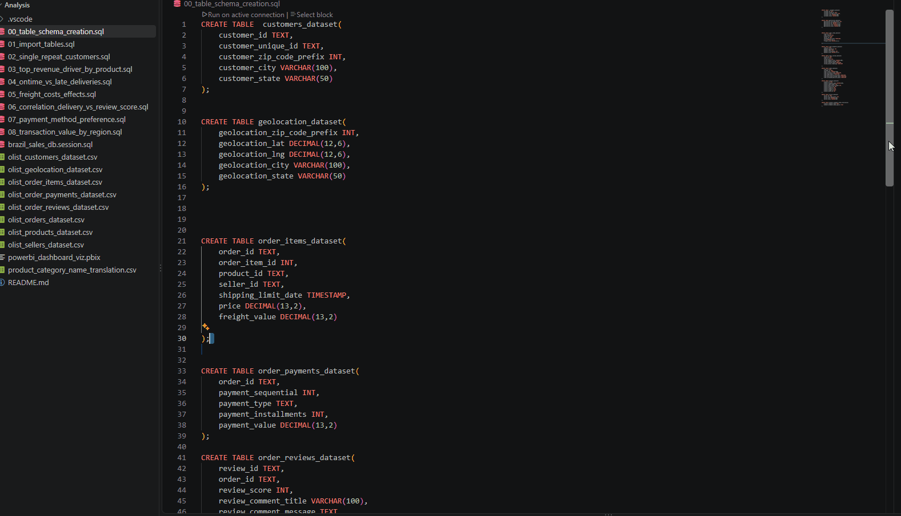
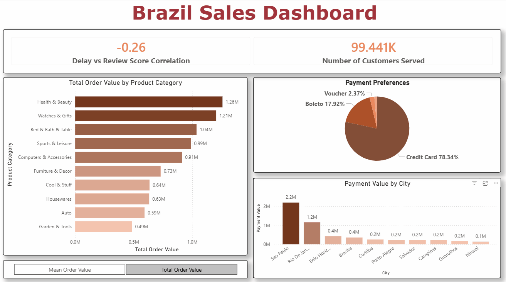
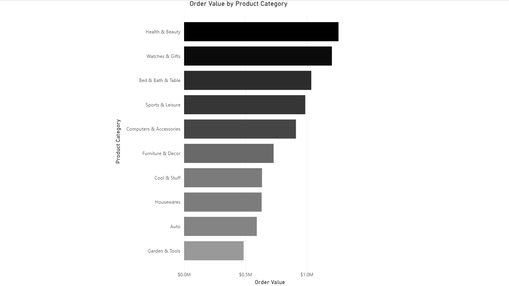
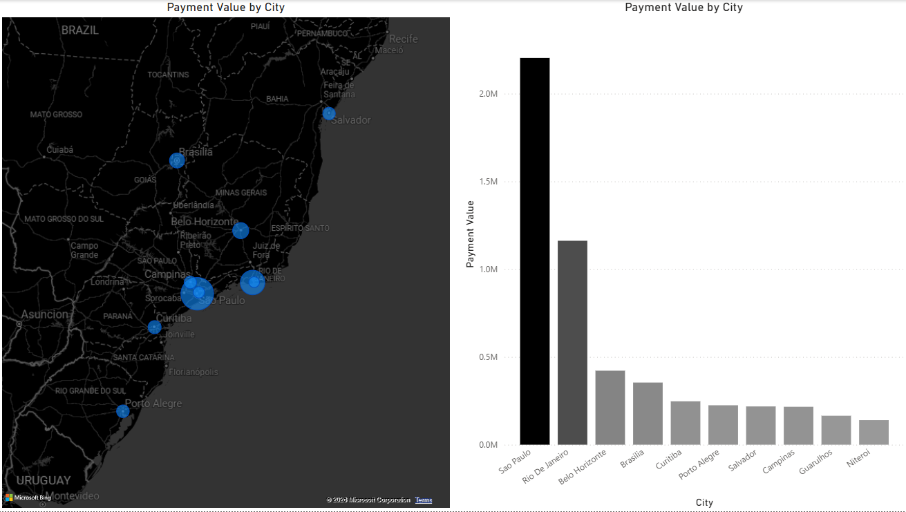
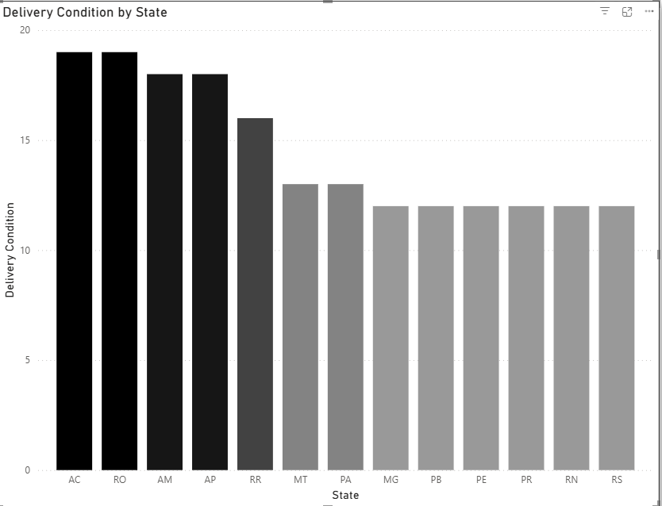
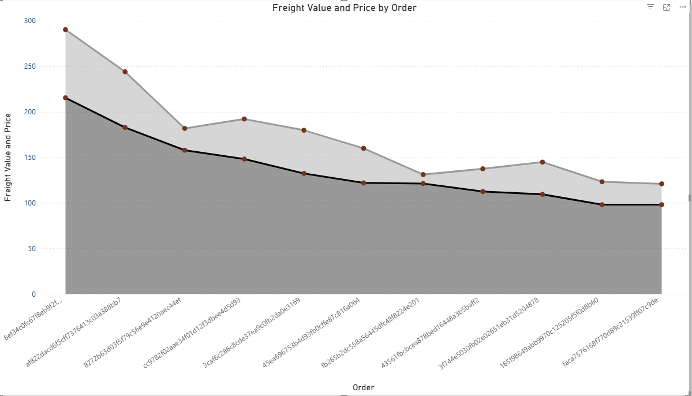
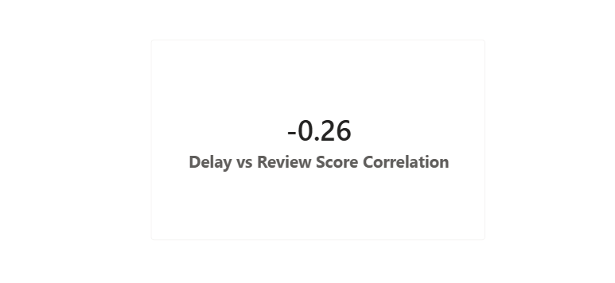
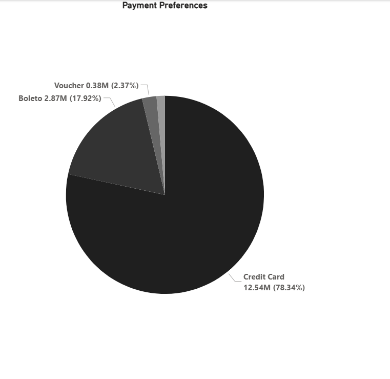

 # Brazil Olist Sales Analysis
 
 ## Executive Summary 
 
 
 ### 🛠️ Technical Stack and Data Pipeline
 - Data source: Kaggle 

 - PostgreSQL (Raw Data) $\rightarrow$ SQL Views (ETL & Transformations) $\rightarrow$ Power BI Native Direct/Import Connection $\rightarrow$ Executive Dashboard.


### 🧐 Purpose of Analysis 
- The main purpose of this analysis is to showcase and also practice  my SQL data exploaration, data cleaning and analysis skills. An adjacent purpose is to look at real world e-commerce orders (around 100k) for a Brazillian organization to identify churn and delivery bottlenecks..


## The Data 



- *In order to start my analysis i ran the data through Excel to explore the data and kind of get a first glance view of the data in order to have an idea of what i will be using to answer the questions that i have jotted down for analysis, after that i imported into my postgresql database*

Have a look at the data [here](csv) and the sql queries [here](sql)

## The Dashboard

 

*Dashboard includes an executive summary and a second page showing logistics and customer related metrics created using Power Bi*

Get the dashboard [here](powerbi_dashboard_viz.pbix)


## Analysis

### Analyzing Revenue and Customer Lifecycle 


**1. Top revenue by product category**  (*Which translated product categories generate 80% of total revenue?*)
-   #### Task
    - For this first question the task is to find out what categories are responsible for msot of the generated revenue.
    
-   #### Action
    - I summed the `order value` and grouped it by the `product category` and in order to achieve that, i also joined the relevant tables (`products_dataset` and `products_category_translation`)

     ```sql

       SELECT 
         INITCAP(REPLACE(pc.product_category_name_english,'_',' & ')) as english_category,
         SUM(oi.price) as order_value
       FROM products_dataset pd
       JOIN product_category_name_translation pc ON pd.product_category_name = pc.product_category_name
       JOIN order_items_dataset oi ON pd.product_id = oi.product_id
       GROUP BY pc.product_category_name_english
       ORDER BY SUM(oi.price) DESC
       LIMIT 10


    
    ```
    
-   #### Result

*Source: Power Bi*

- #### Interpretation
  - From the analysis and visualization above, the categories `Health & Beauty, Watches & Gifts, Bed,Bath & Table` are in the top three in revenue generation for Olist indicating that its consumers are mainly beauty,leisure/luxury oriented.

**1. Top revenue by city state**  (*Which translated city/state generates maojority of total revenue?*)

-   #### Task
     - Which cities in Brazil contribute significantly into the reveneue pool more than others?
 
-   #### Action
     
     - For this task I simply summed up the value column and grouped it by the city, ordered by the amounts/ value in descending order and then limited to only the top ten most significant cities.

     ```sql 
     SELECT 
          cd.customer_city as city,
          SUM(op.payment_value) as value
     FROM customers_dataset cd
     LEFT JOIN orders_dataset od ON cd.customer_id = od.customer_id
     LEFT JOIN order_payments_dataset op ON od.order_id = op.order_id
     GROUP BY cd.customer_city
     ORDER BY SUM(op.payment_value) DESC
     LIMIT 10
     ```
    
-   #### Result

*Source: Power Bi*

- #### Interpretation
     - Sao Paulo and Rio De Janeiro contribute twice, three or more times than the preceeding city regions (as is the case for Sao Paulo). This is an anticipated result because the two cities are the main hubs for bsuiness and commerce as well as sesrving as the most populated metropolitans in Brazil.

### Analyzing Operational and Logistics Efficiency

**1. On-time vs Late Delivery impact**
 (*What is the average delivery delay per Brazilian state, and how many days late are packages on average?*)


-   #### Task
     - Here i needed to answer two questions, are deliveries often late? and if late, how many days on average are they late, in the following tasks i also look into the correlation between delivery time and customer satisfaction(guided by reviews) 
 
-   #### Action
     - To begin i created a base table in which i calculated the delivery time by averaging the difference between the `estimated_delivery_time` and `delivered_custoemr_date` which is the actual delivery date and then used a `CASE` statement to then distinguish the late from the early deliveries.

     ```sql
     SELECT 
          cd.customer_state as delivery_state,
          AVG(AGE(od.order_estimated_delivery_date, od.order_delivered_customer_date)) as delivery_time,
          CASE WHEN EXTRACT(DAY FROM AVG(AGE(od.order_estimated_delivery_date, od.order_delivered_customer_date))) > 0 THEN 'Early'
          ELSE 'Late' END AS delivery_delay
     FROM orders_dataset od
     JOIN customers_dataset cd ON od.customer_id = cd.customer_id
     WHERE od.order_delivered_customer_date IS NOT NULL
     GROUP BY cd.customer_state
     ORDER BY AVG(AGE(od.order_estimated_delivery_date, od.order_delivered_customer_date)) DESC

          

     SELECT
          delivery_state,
          EXTRACT(DAY FROM delivery_time) as avg_early_late_delivery_days,
          delivery_delay
     FROM base_table
     ```

-   #### Result

*Source: Power Bi*

- #### Interpretation
     - For most, if not all(per the dataset) the deliveries were early indicating a fast and seemingly effecient delivery system

**2. Shipping freight costs as a % of order value**
 (*Are high freight charges causing cart abandonment or lowering net margins on low-cost products?*)


-   #### Task
     - The task here is to see how much of the whole cost to the customer can be attributed to just shipping fees alone 
 
-   #### Action
     - In order to uncover the effect of shipping costs on the final fee charged to customers,I queried for the whole price and then the freight cost and subsequently divided the freight value by the total price as the `freight_per_product`. The results are then ordered by the freight perecentage

     ```sql 
     SELECT 
          order_id,
          price,
          freight_value,
     ROUND((freight_value / price)* 100,2) as freight_per_product
     FROM order_items_dataset
     ORDER BY freight_per_product DESC
     LIMIT 200
     ```

-   #### Result

*Source: Power Bi*

- #### Interpretation
     - For cheaper products, freight seems to be te major driver of cost as compared to more expensive products. In other words, with regard to freight cost, it is cost effective to buy an expensive product and bear the cost , then to buy a cheap product and pay double or 3 times the cost for freight.

### Analyzing Customer Satisfaction And Review Analytics

**1. Delivery Speed vs Customer Review Ratings**
(*Does a 3-day delivery delay lead to a statistically significant drop in review scores (1-star reviews)?*)


-   #### Task
     - After looking at the delivery times and delays in the previous task, the next question to answer is whether there is a correlation betweeb delivery delay and review scores.
 
-   #### Action
     - In this case, i extracted the days from the difference between the estimated delivery date and the actual delivery date and then calculated the correlation coefficient between that and the review score variable.

     ```sql
     SELECT 
          CORR(
               ord.review_score, EXTRACT( DAY FROM (od.order_delivered_customer_date - od.order_estimated_delivery_date))
           ) as correlation_delay_vs_review
     FROM orders_dataset od
     JOIN order_reviews_dataset ord ON od.order_id=ord.order_id
     WHERE od.order_status = 'delivered' 
     AND od.order_estimated_delivery_date IS NOT NULL
     AND od.order_estimated_delivery_date IS NOT NULL
     ```

-   #### Result

*Source: Power Bi*

- #### Interpretation
     - The correlation coefficient (r) indicates the relation between two variables. The coefficient result when calculated should be between -1 and 1 (*Negative correlation indicates an inverse relation and Positive correlation indicates a direct relation of the two variables and the number indicates the strength of the relation*). 
     - In the case of delivery delay and the review score, the `r` is -0.26 indicating a weak negative relationship betwen the two, which means an increase in delays results in a decrease in the review scores and vice-versa as customers will be experssing their frsutration of late delieries through the review system, however the low relation also reveals tha there are other factors that affect the review score.

### Payment Method Preferrence

**1. Installment Payment Preferences**
(*Do customers making high-value purchases prefer credit card installments over Boleto/Voucher?*)

-   #### Task
     - To end this analysis, i look at which payment method is generally preferred in Brazil  per the Olist dataset.
 
-   #### Action
     - To accomplish the task, i averaged all the payments made and the summed up the payments made, then grouped them by the payment type, ordered by the payment amounts in descending order.

     ```sql
     SELECT 
          payment_type,
          ROUND(AVG(payment_installments),4) as avg_payment_installments,
          SUM(payment_value) as total_payment_value
     FROM order_payments_dataset
     GROUP BY payment_type
     ORDER BY SUM(payment_value) DESC

     ```

-   #### Result

*Source: Power Bi*

- #### Interpretation

     - Basing on the dataset, most of the payments made have been made through credit cards, making them the most preferred method of payment for the customers accounting for `78.34%` of all payments made, second is Boleto with `17.92%` and the least used is the Voucher with `2.37%`
